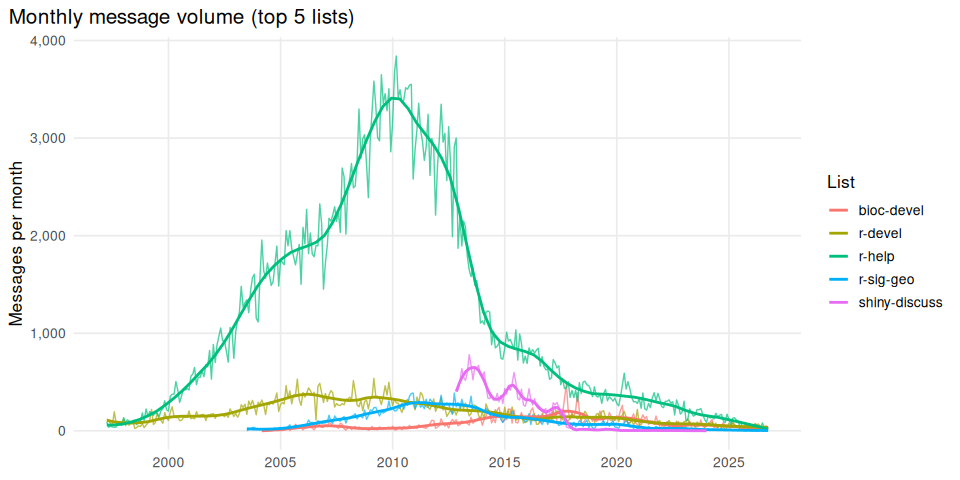
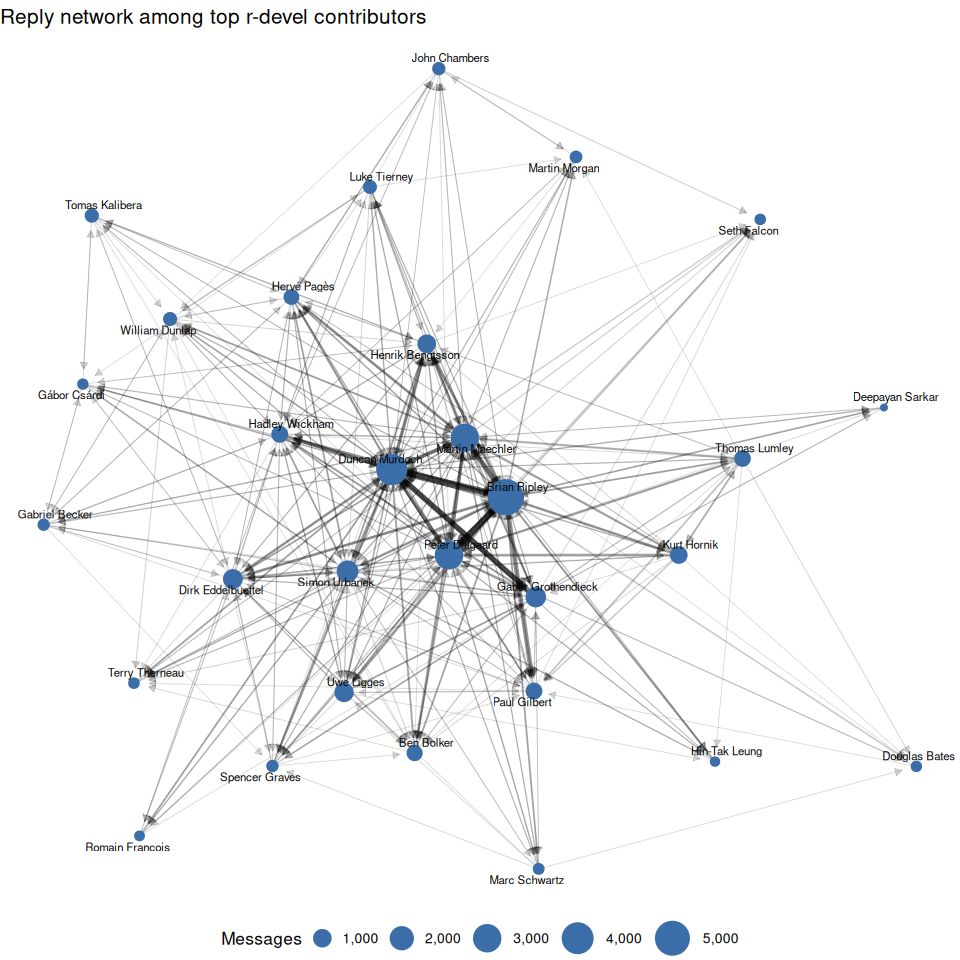

# R Mailing List Data: Demo Analysis


- [Setup](#setup)
- [Message volume over time](#message-volume-over-time)
- [Top posters by list](#top-posters-by-list)
- [Reply network on r-devel](#reply-network-on-r-devel)
- [Contributors across lists](#contributors-across-lists)

This notebook demonstrates how to work with the R mailing list Parquet
data. See the [main README](../README.md) for setup instructions and
data dictionary.

## Setup

### Using convenience functions

Source the helper script to download and cache data automatically — no
cloning required:

``` r
source("https://raw.githubusercontent.com/r-mailing-lists/data/main/scripts/rml.R")
```

``` r
library(dplyr, warn.conflicts = FALSE)
library(scales)
library(ggplot2)

theme_set(
  theme_minimal(base_size = 13) +
    theme(
      panel.grid.minor = element_blank(),
      plot.title.position = "plot"
    )
)

# Load aliases for name resolution
resolve_aliases <- function(df) {
  aliases_file <- "../aliases.json"
  if (!file.exists(aliases_file)) return(df)
  alias_data <- jsonlite::fromJSON(aliases_file)
  lookup <- data.frame(
    from_email_hash = unlist(alias_data$aliases$email_hashes),
    canonical_name = rep(alias_data$aliases$canonical_name,
                         lengths(alias_data$aliases$email_hashes)),
    stringsAsFactors = FALSE
  )
  df |>
    left_join(lookup, by = "from_email_hash") |>
    mutate(from_name = ifelse(is.na(canonical_name), from_name, canonical_name)) |>
    select(-canonical_name)
}
```

The helper provides four main functions:

``` r
# See all available mailing lists
rml_available()
```

      [1] "abernethy-reliability"   "adegenet-forum"         
      [3] "basta-users"             "batman-users"           
      [5] "bioc-devel"              "bioc-ggtree"            
      [7] "bioc-sig-proteomics"     "bioc-sig-sequencing"    
      [9] "biocbug"                 "bioconductor"           
     [11] "biogeobears"             "blavaan"                
     [13] "boostheaders-devel"      "braingraph-help"        
     [15] "brms-users"              "camtrapr"               
     [17] "canopy-phylogeny"        "catlearn-package"       
     [19] "chnosz-help"             "cipsr-users"            
     [21] "corpling-with-r"         "cran2deb-discuss"       
     [23] "ctmm-user"               "ctsem-mail"             
     [25] "dartr"                   "datatable-help"         
     [27] "davis-rug"               "deducer"                
     [29] "dirichletreg-news"       "distance-sampling"      
     [31] "distr-distr"             "dynr"                   
     [33] "eventstudies-discussion" "expm-developers"        
     [35] "ez4r"                    "flr-list"               
     [37] "forensim-help"           "fresh-tor4"             
     [39] "ftree-community"         "genabel-announce"       
     [41] "genabel-devel"           "genoplotr-help"         
     [43] "geomorph-r-package"      "ggplot2"                
     [45] "ggvis"                   "gsoc-dowd"              
     [47] "gsoc-porta"              "gsoc-r"                 
     [49] "gwidgets-questions"      "hmecology"              
     [51] "hyperspec-help"          "immcantation-news"      
     [53] "inlinedocs-support"      "ipmpack-users"          
     [55] "irace-package"           "isorix"                 
     [57] "israel-r-user-group"     "knitr"                  
     [59] "lavaan"                  "listpackage-discuss"    
     [61] "mailman"                 "manipulatr"             
     [63] "mediation-information"   "metacoder-discussions"  
     [65] "metrology-devel"         "mirt-package"           
     [67] "mixvir"                  "monetr-users"           
     [69] "mplusautomation"         "mvabund-faqs"           
     [71] "mvabund-updates"         "nat-user"               
     [73] "netlogor"                "nimble-users"           
     [75] "nlsy-links"              "nmf-user"               
     [77] "nmof-news"               "orchestra-users"        
     [79] "oscr-package"            "pez-users"              
     [81] "phenopix-developers"     "phylobase-devl"         
     [83] "phylogram"               "picante-devel"          
     [85] "piecepackr"              "pomp-announce"          
     [87] "poppr"                   "qcawithr"               
     [89] "qtinterfaces-devel"      "r-and-cpp"              
     [91] "r-announce"              "r-br"                   
     [93] "r-devel"                 "r-forge-testing-testing"
     [95] "r-gregmisc-devel"        "r-help"                 
     [97] "r-help-es"               "r-hiphop"               
     [99] "r-inla-discussion-group" "r-marketing-bugs"       
    [101] "r-package-devel"         "r-package-xlsx"         
    [103] "r-packages"              "r-sig-db"               
    [105] "r-sig-dcm"               "r-sig-debian"           
    [107] "r-sig-dynamic-models"    "r-sig-ecology"          
    [109] "r-sig-epi"               "r-sig-fedora"           
    [111] "r-sig-finance"           "r-sig-genetics"         
    [113] "r-sig-geo"               "r-sig-gr"               
    [115] "r-sig-gui"               "r-sig-hpc"              
    [117] "r-sig-insurance"         "r-sig-jobs"             
    [119] "r-sig-mac"               "r-sig-mediawiki"        
    [121] "r-sig-meta-analysis"     "r-sig-mixed-models"     
    [123] "r-sig-networks"          "r-sig-phylo"            
    [125] "r-sig-qa"                "r-sig-robust"           
    [127] "r-sig-rugs"              "r-sig-teaching"         
    [129] "r-sig-wiki"              "r-sig-windows"          
    [131] "r-ug-ottawa"             "rangemapper-news"       
    [133] "rattle-users"            "rcicr-users"            
    [135] "rcpp-devel"              "rcppoctave-user"        
    [137] "rdevtools"               "reddyproc-users"        
    [139] "remoterengine-devel"     "repitools-help"         
    [141] "rgeos-devel"             "rhadoop"                
    [143] "rhipe"                   "right-user"             
    [145] "riskassessment-news"     "rmetrics-core"          
    [147] "rnomads-user"            "robustbase-authors"     
    [149] "ropengov-forum"          "roxygen-devel"          
    [151] "rpackageggir"            "rphree-general"         
    [153] "rprotobuf-yada"          "rqtl-announce"          
    [155] "rqtl-disc"               "rqtl2-disc"             
    [157] "rquantlib-devel"         "rserlang-develop"       
    [159] "rsiena-help"             "rsnns"                  
    [161] "rspatial-devel"          "rworldmap"              
    [163] "sciviews-help"           "sciviews-news"          
    [165] "secrgroup"               "seewave"                
    [167] "seqinr-forum"            "sequenza-user-group"    
    [169] "shiny-discuss"           "shinyapps-users"        
    [171] "simmer-devel"            "simplephenotypes"       
    [173] "simsalabim-communicate"  "sorvi-admin"            
    [175] "spades-users"            "spdep-devel"            
    [177] "spocc-spabund-users"     "sprint-developer"       
    [179] "sprint-user"             "sqldf"                  
    [181] "stan-dev"                "stan-users"             
    [183] "synbreed-news"           "tidylpa"                
    [185] "tikzdevice-bugs"         "tlocoh-info"            
    [187] "tmb-users"               "traminer-users"         
    [189] "travelr-announce"        "travelr-discussion"     
    [191] "trophicposition-support" "tsdyn"                  
    [193] "uhcluster-members"       "unmarked"               
    [195] "viennar-meetup"          "vim-r-plugin"           
    [197] "wallaceecomod"           "yuima-wishlist"         
    [199] "zipfr-users"            

``` r
# Read a single list (use col_select to skip the body — much faster)
r_devel <- rml_read("r-devel",
  col_select = c("from_name", "date", "subject", "thread_id", "month"))

str(r_devel)
```

    Classes 'tbl' and 'data.frame': 63736 obs. of  5 variables:
     $ from_name: chr  "Martin Maechler" "Kurt Hornik" "Martin Maechler" "Martin Maechler" ...
     $ date     : POSIXct, format: "1997-04-01 08:28:56" "1997-04-01 08:35:43" ...
     $ subject  : chr  "R-alpha: Re: R-Prerelease  ---- Mailing list  \"R-devel\"" "R-alpha: Re: R-Prerelease  ---- Mailing list  \"R-devel\"" "R-alpha: Re: Pretest Version + Notes --- write.table" "R-alpha: R0.50-pre6:  \"stack imbalance in ...\" //  is.vector(matrix...)" ...
     $ thread_id: chr  "thread-0823a0ef3954" "thread-0823a0ef3954" "thread-87797c263db4" "thread-95d55ddd69bf" ...
     $ month    : chr  "1997-04" "1997-04" "1997-04" "1997-04" ...

``` r
# Thread-level summaries across all lists
threads <- rml_read_threads(col_select = c("list", "message_count"))
head(threads)
```

    # A data frame: 6 × 2
      list                  message_count
    * <chr>                         <int>
    1 abernethy-reliability             1
    2 abernethy-reliability             1
    3 adegenet-forum                    1
    4 adegenet-forum                    2
    5 adegenet-forum                    1
    6 adegenet-forum                    1

``` r
# Contributor statistics across all lists
contribs <- rml_read_contributors()
head(contribs)
```

    # A data frame: 6 × 7
      name     message_count list_count lists list_counts first_message last_message
    * <chr>            <int>      <int> <chr> <chr>       <chr>         <chr>       
    1 Brian R…         17995         15 r-he… r-help:117… 1998-06-04T1… 2026-09-07T…
    2 Duncan …         12600         14 r-he… r-help:733… 2000-02-16T2… 2026-10-06T…
    3 David W…         11694         16 r-he… r-help:110… 2003-03-07T1… 2026-08-23T…
    4 Peter D…         10834         12 r-he… r-help:707… 1997-04-01T0… 2026-10-11T…
    5 Bob Car…         10378          2 stan… stan-users… 2011-11-07T1… 2017-06-06T…
    6 Gabor G…         10081         19 r-he… r-help:804… 2002-01-12T1… 2026-10-03T…

### Working directly with Parquet files

To work from local copies, download the files from the [`parquet`
release](https://github.com/r-mailing-lists/data/releases/tag/parquet)
(`gh release download parquet --repo r-mailing-lists/data --dir data`)
and read them directly with
[`nanoparquet`](https://cran.r-project.org/package=nanoparquet):

``` r
library(nanoparquet)

# Single list
r_devel <- read_parquet("data/r-devel.parquet")

# All lists: every file except the two summaries
files <- setdiff(list.files("data", pattern = "\\.parquet$"),
                 c("threads.parquet", "contributors.parquet"))
all_msgs <- do.call(rbind, lapply(file.path("data", files), read_parquet,
  col_select = c("list", "from_name", "date", "subject", "month")))

# Threads and contributors
threads <- read_parquet("data/threads.parquet")
contribs <- read_parquet("data/contributors.parquet")
```

## Message volume over time

``` r
# Read all lists into one data frame
all_msgs <- do.call(rbind, lapply(rml_available(), function(l) {
  rml_read(l, col_select = c("list", "from_name", "date", "month"))
}))

monthly <- all_msgs |>
  filter(date >= as.POSIXct("1997-01-01", tz = "UTC")) |>
  count(list, month) |>
  mutate(date = as.Date(paste0(month, "-01")))

top_lists <- monthly |>
  group_by(list) |>
  summarise(total = sum(n)) |>
  slice_max(total, n = 5) |>
  pull(list)

monthly |>
  filter(list %in% top_lists) |>
  ggplot(aes(date, n, color = list)) +
  geom_line(alpha = 0.7, linewidth = 0.5) +
  geom_smooth(se = FALSE, linewidth = 1, span = 0.15) +
  scale_y_continuous(labels = label_comma()) +
  scale_x_date(date_breaks = "5 years", date_labels = "%Y") +
  labs(
    title = "Monthly message volume (top 5 lists)",
    x = NULL, y = "Messages per month", color = "List"
  )
```

<div id="fig-timeline">



Figure 1

</div>

## Top posters by list

``` r
r_devel <- rml_read("r-devel",
  col_select = c("from_name", "from_email_hash", "date", "subject")) |>
  resolve_aliases()

recent <- r_devel[r_devel$date >= as.POSIXct(Sys.Date() - 365), ]
head(sort(table(recent$from_name), decreasing = TRUE), 10)
```

                           Ivan Krylov                    Martin Maechler 
                                    38                                 38 
                     Dirk Eddelbuettel iuke-tier@ey m@iii@g oii uiow@@edu 
                                    31                                 23 
                        Duncan Murdoch                        Kurt Hornik 
                                    22                                 22 
                        Peter Dalgaard                      Simon Urbanek 
                                    20                                 20 
                            Ben Bolker    Suharto Anggono Suharto Anggono 
                                    16                                 16 

## Reply network on r-devel

The `in_reply_to` field links each message to its parent, making it
straightforward to build a “who replies to whom” network.

``` r
library(igraph)
library(ggraph)

r_devel <- rml_read("r-devel",
  col_select = c("message_id", "from_name", "from_email_hash", "in_reply_to")) |>
  resolve_aliases()

# Build edges: replier -> original author
author_lookup <- r_devel |> select(message_id, from_name)

edges <- r_devel |>
  filter(!is.na(in_reply_to)) |>
  inner_join(author_lookup, by = c("in_reply_to" = "message_id"), suffix = c("_from", "_to")) |>
  filter(from_name_from != from_name_to) |>
  count(from = from_name_from, to = from_name_to, name = "replies")

# Keep only the most active participants
top_authors <- r_devel |>
  count(from_name, sort = TRUE) |>
  head(30) |>
  pull(from_name)

edges_top <- edges |>
  filter(from %in% top_authors, to %in% top_authors, replies >= 5)

g <- graph_from_data_frame(edges_top, directed = TRUE)

# Size nodes by total messages
msg_counts <- r_devel |>
  filter(from_name %in% V(g)$name) |>
  count(from_name)
V(g)$messages <- msg_counts$n[match(V(g)$name, msg_counts$from_name)]

# The layout and the label placement are both random. A fixed seed means
# the picture only changes when the data does.
set.seed(2026)
ggraph(g, layout = "fr") +
  geom_edge_link(
    aes(width = replies, alpha = replies),
    arrow = arrow(length = unit(2, "mm"), type = "closed"),
    end_cap = circle(4, "mm")
  ) +
  geom_node_point(aes(size = messages), color = "#3B6EA8") +
  geom_node_text(aes(label = name), repel = TRUE, size = 3, max.overlaps = 20) +
  scale_edge_width(range = c(0.3, 2.5), guide = "none") +
  scale_edge_alpha(range = c(0.15, 0.6), guide = "none") +
  scale_size_continuous(range = c(2, 12), labels = label_comma(), name = "Messages") +
  labs(title = "Reply network among top r-devel contributors") +
  theme_void(base_size = 13) +
  theme(plot.title.position = "plot", legend.position = "bottom")
```

<div id="fig-reply-network">



Figure 2

</div>

## Contributors across lists

``` r
contribs <- rml_read_contributors()
contribs |>
  arrange(desc(message_count)) |>
  head(20) |>
  select(name, message_count, list_count) |>
  knitr::kable()
```

| name               | message_count | list_count |
|:-------------------|--------------:|-----------:|
| Brian Ripley       |         17995 |         15 |
| Duncan Murdoch     |         12600 |         14 |
| David Winsemius    |         11694 |         16 |
| Peter Dalgaard     |         10834 |         12 |
| Bob Carpenter      |         10378 |          2 |
| Gabor Grothendieck |         10081 |         19 |
| Uwe Ligges         |          8576 |         19 |
| Dirk Eddelbuettel  |          7984 |         23 |
| Ben Bolker         |          6270 |         11 |
| Bert Gunter        |          6050 |         10 |
| Martin Maechler    |          5900 |         26 |
| jim holtman        |          4445 |          6 |
| Ben Goodrich       |          4432 |          2 |
| Jeff Newmiller     |          4378 |          7 |
| Martin Morgan      |          4345 |          8 |
| Simon Urbanek      |          4332 |         14 |
| Roger Bivand       |          4314 |         16 |
| Jim Lemon          |          3886 |          6 |
| Thomas Lumley      |          3794 |          9 |
| Marc Schwartz      |          3770 |         10 |
